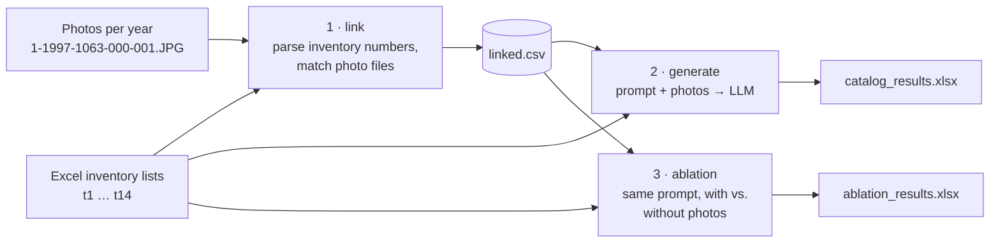

# Museum Catalog LLM

[](https://github.com/FatihKocHTW/museum-catalog-llm/actions/workflows/ci.yml)


Generates museum catalogue entries from **raw inventory exports and object photos** using a multimodal
LLM (OpenAI `gpt-4o-mini`), and runs an **ablation study** that compares descriptions generated from
metadata alone with descriptions generated from metadata plus photos.

Museum inventory exports are often terse: cryptic column names (`t1` … `t14`), inconsistent values and
photos stored separately by file-naming convention. This pipeline joins both sources and turns them into
structured, source-aware catalogue text, with explicit rules against invented facts.

## How it works



**1 · Link** – Inventory numbers such as `1/1997/1063 0` (group / year / number / series) are parsed with
a regular expression and matched to photo files in the corresponding year folder
(`1997/1-1997-1063-*.JPG`). All series of one object are grouped together; unmatched records are written
to a separate miss log for data-quality review.

**2 · Generate** – For each object, the cleaned metadata is rendered into a curator prompt and sent
together with up to three photos. The prompt asks the model to transcribe visible inscriptions, describe
controls, materials and condition, flag conflicts between metadata and photos, and label every
inference as an assumption.

**3 · Ablation** – The same prompt is sent twice per object, once text-only and once with photos
(temperature 0 for comparability). Both outputs land side by side in one spreadsheet, together with the
exact prompt, so the added value of visual input can be reviewed object by object.

### Engineering details

- **Rate-limit handling:** exponential backoff with jitter, honours `Retry-After` on HTTP 429
- **Robust input handling:** `.xls`/`.xlsx` fallback, normalisation of `NaN` and bracket annotations,
  several image-list formats
- **Fault-tolerant batches:** a failed request is recorded in the output instead of aborting the run
- **Prompts as files:** templates live in `src/museum_catalog/prompts/` and can be versioned and
  compared independently of the code
- **Tested without API calls:** 44 tests with a fake collection and a stubbed HTTP session, run on
  every push via GitHub Actions

## Project structure

```
src/museum_catalog/
├── cli.py          # command line interface (link / generate / ablation)
├── config.py       # paths, row ranges, column labels, model settings
├── linking.py      # step 1: inventory number parsing and photo matching
├── pipeline.py     # steps 2 and 3: generation and ablation
├── llm.py          # OpenAI client with retry/backoff
├── io_utils.py     # Excel loading, cleaning, image resolution
└── prompts/        # prompt templates (*.txt)
tests/              # pytest suite, no network access needed
data/               # place inventory lists and photos here (not in the repo)
```

## Getting started

```bash
git clone https://github.com/FatihKocHTW/museum-catalog-llm.git
cd museum-catalog-llm
python -m venv .venv && source .venv/bin/activate   # Windows: .venv\Scripts\activate
pip install -e ".[dev]"
cp .env.example .env                                 # then add your OPENAI_API_KEY
```

Place the data as described in [`data/README.md`](data/README.md), then run:

```bash
python -m museum_catalog link                     # -> output/linked.csv
python -m museum_catalog generate --limit 3       # -> output/catalog_results.xlsx
python -m museum_catalog ablation --limit 10      # -> output/ablation_results.xlsx
```

Useful options: `--start-at N`, `--model`, `--max-images`, `--show-prompts`, `-v`.

Run the tests:

```bash
pytest -q
```

## Data

The inventory data and photos belong to the museum collection and are **not included** in this
repository. The tests use a small synthetic collection generated on the fly.

## Tech stack

Python · pandas · OpenAI Chat Completions API (vision) · requests · pytest · ruff · GitHub Actions
